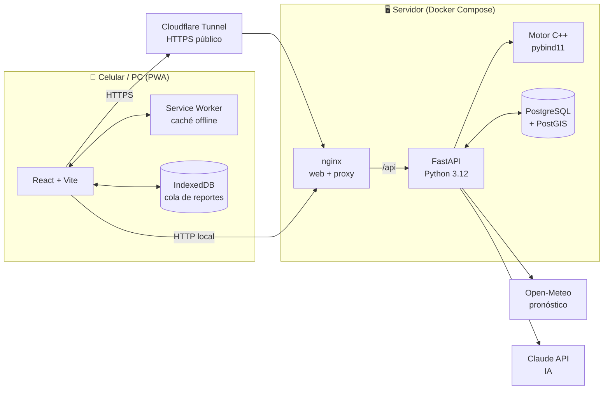
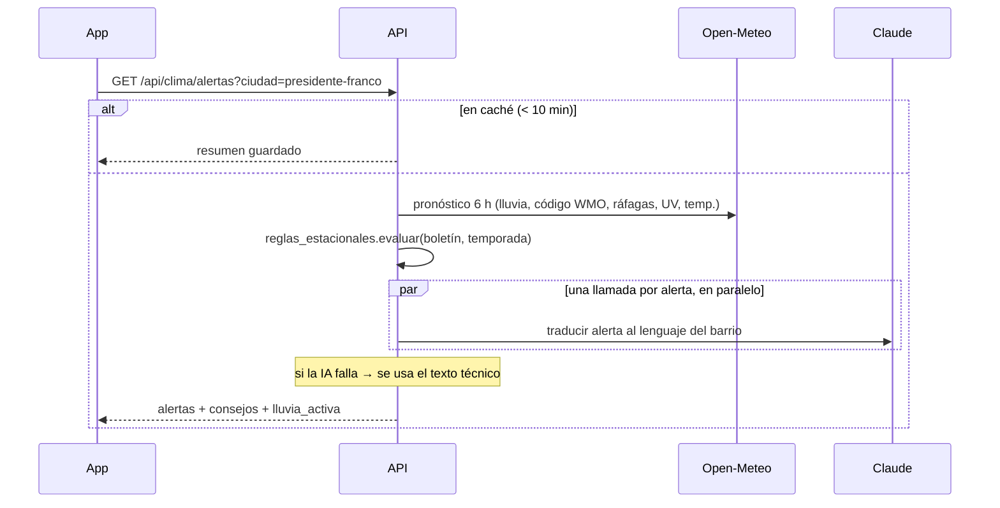
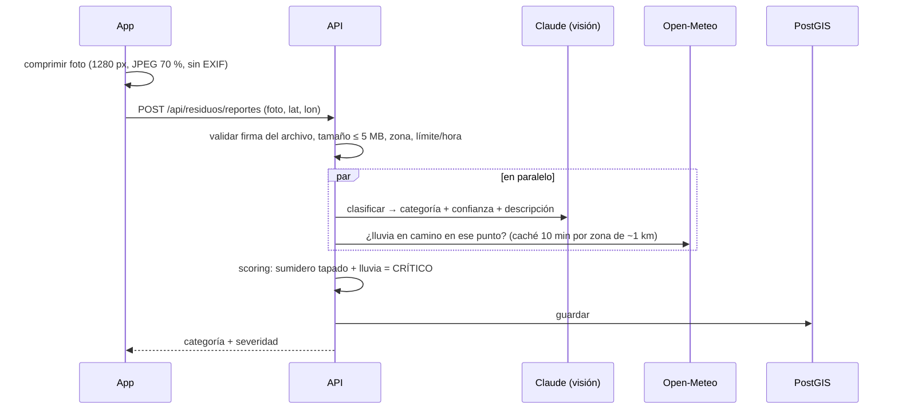
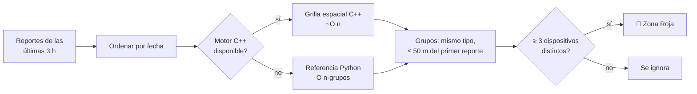
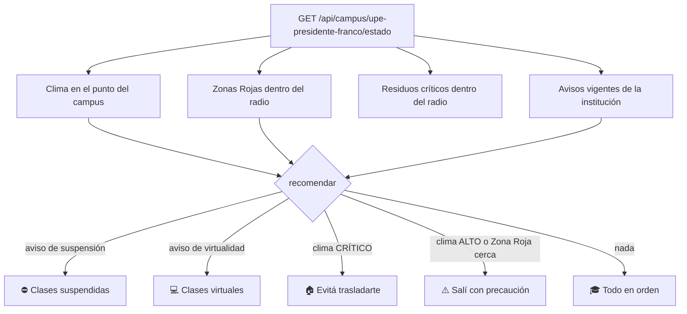
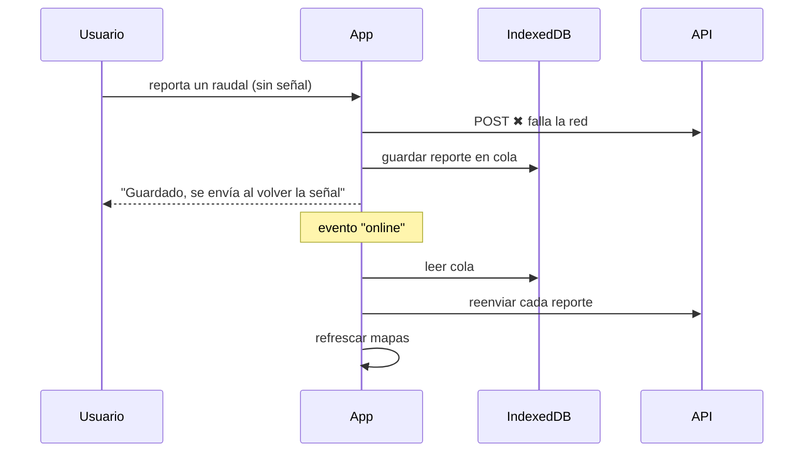

# Cómo funciona Ñangarekó IA

Informe técnico del proyecto: qué hace cada parte, cómo fluyen los datos y por qué se tomó cada decisión.

---

## 1. Visión general

Ñangarekó IA es una **app web progresiva (PWA)**: se instala en Android, iPhone o PC desde el navegador y funciona con poca o ninguna señal. Tiene cinco secciones:

| Sección | Nombre | Para qué sirve |
|---|---|---|
| ⛈️ Clima | **Aratiri & Oky** | Alertas del pronóstico de 6 h, ajustadas a El Niño / La Niña y explicadas en lenguaje del barrio por IA. |
| 🚦 Tránsito | **Tape Ysyry** | Reportes de 1 toque (raudal, semáforo/cable, bache). Tres vecinos distintos a menos de 50 m forman una **Zona Roja**. |
| 📷 Reportar | **Yty & Sumideros** | Foto + GPS: la IA clasifica la basura y calcula el riesgo según el clima. Incluye el calendario del camión recolector. |
| 🗺️ Mapa | **Mapa de Riesgo Urbano** | Todos los reportes de residuos de los últimos 30 días, por severidad. |
| 🎓 Campus | **Modo Campus** | Para estudiantes: estado de su institución (clima, tránsito cercano, avisos oficiales) y una recomendación de "¿voy a clase?". |

Además, **⚙️ Ajustes** permite elegir modo claro, oscuro o el del sistema y un color de la paleta (o uno personalizado).

---

## 2. Arquitectura



### Backend: Clean Architecture por módulo

Cada módulo (`clima`, `residuos`, `transito`, `campus`) tiene las mismas capas:

```
backend/app/modules/<módulo>/
  domain.py          Modelos y enums puros (sin dependencias)
  <reglas>.py        Lógica de negocio pura y testeable
  ports.py           Interfaces (Protocol) de lo externo: IA, clima, base de datos
  use_cases.py       Orquesta dominio + puertos
  infra/             Adaptadores concretos: Open-Meteo, Claude, PostGIS
  api.py             Endpoints FastAPI + DTOs (Pydantic)
```

Las reglas de negocio no saben de HTTP ni de SQL. Por eso los tests pueden reemplazar la IA, el clima y la base por versiones falsas en memoria y recorrer la API completa sin red.

### Frontend: organizado por funcionalidad

```
frontend/src/
  shared/            Cliente HTTP + cola offline, hooks, tema, componentes UI (Badge, Mapa, Skeleton…)
  features/          clima/  transito/  residuos/  campus/  ajustes/
```

Solo la portada (Clima) va en la descarga inicial, de unos 113 KB comprimidos. El resto de las secciones, incluido Leaflet para los mapas, se descarga recién cuando se abre.

---

## 3. Flujos principales

### 3.1 Alerta climática



Reglas (`backend/app/modules/clima/reglas_estacionales.py`):

| Alerta | Condición | Severidad |
|---|---|---|
| Tormenta | código WMO ≥ 95 o ráfagas ≥ 60 km/h | CRÍTICO si granizo (≥ 96) o ráfagas ≥ 90 |
| Lluvia intensa | ≥ 30 mm en 6 h (**≥ 20 mm en El Niño**) | CRÍTICO al doble del umbral |
| Incendio | **La Niña** + ≥ 35 °C + lluvia < 20 % | CRÍTICO ≥ 38 °C |
| Calor | ≥ 38 °C fuera de La Niña | ALTO |
| UV | ≥ 11 (**≥ 8 en La Niña**) | CRÍTICO ≥ 11 |

### 3.2 Reporte de basura con foto



Si la IA falla o la foto no muestra basura, el reporte **se guarda igual** como `PENDIENTE`. Nunca se pierde.

### 3.3 Zona Roja de tránsito (anti-spam)



Un mismo celular que reporta diez veces cuenta como **un** dispositivo. Así un spammer no puede inventar una Zona Roja.

### 3.4 Modo Campus



La prioridad está en `backend/app/modules/campus/recomendacion.py`: un aviso oficial de la institución gana sobre todo lo demás.

### 3.5 Sin señal (offline)



El service worker además guarda la app, los mapas ya vistos (30 días) y la última respuesta de cada consulta, así se puede abrir la app sin señal.

---

## 4. API

Documentación interactiva: **http://localhost:8000/docs** (Swagger).

| Método | Ruta | Descripción |
|---|---|---|
| GET | `/api/salud` | Estado, motor de agrupación (`c++`/`python`) y modo demo |
| GET | `/api/clima/ciudades` | Ciudades soportadas |
| GET | `/api/clima/alertas?ciudad=` | Alertas + consejos + lluvia activa |
| POST | `/api/residuos/reportes` | Foto (multipart) + lat/lon → clasificación y severidad |
| GET | `/api/residuos/mapa` | Reportes de los últimos 30 días |
| GET | `/api/residuos/calendario` | Recorridos del camión y próximo paso |
| POST | `/api/transito/reportes` | `{tipo, lat, lon}` |
| GET | `/api/transito/zonas-rojas` | Zonas Rojas validadas |
| GET | `/api/campus/instituciones` | Instituciones educativas |
| POST | `/api/campus/instituciones` 🔐 | Agregar institución |
| GET | `/api/campus/{slug}/estado` | Estado del campus + recomendación |
| POST | `/api/campus/{slug}/avisos` 🔐 | Publicar aviso |

🔐 = requiere el header `X-Admin-Token` igual a `ADMIN_TOKEN`. Si `ADMIN_TOKEN` está vacío, la administración queda deshabilitada (403).
Los reportes ciudadanos usan `X-Device-Id`, un identificador anónimo que genera el celular y que solo sirve para el anti-spam. Nunca se devuelve en las respuestas.

---

## 5. Datos

PostgreSQL + PostGIS. Las ubicaciones son `geography(Point, 4326)` con índices espaciales GiST.

| Tabla | Contenido |
|---|---|
| `reportes_residuos` | ubicación, categoría, confianza, descripción, severidad, dispositivo, fecha |
| `reportes_transito` | ubicación, tipo, dispositivo, fecha |
| `instituciones` | slug, nombre, ciudad, ubicación, radio de influencia |
| `avisos` | institución, tipo, título, mensaje, vigencia |

**Migraciones:** `backend/db/esquema/NNN_*.sql`. El servicio `migrar` de Docker Compose las aplica en orden en cada arranque. Son idempotentes (`IF NOT EXISTS`, `ON CONFLICT DO NOTHING`), así que una base existente se actualiza sola sin perder datos. Para cambiar el esquema, agregá `003_lo_que_sea.sql`.

---

## 6. Motor nativo en C++

El cálculo de Zonas Rojas compara reportes entre sí. Con miles de reportes en una tormenta grande, la versión Python, que compara cada reporte con todos los grupos, se vuelve lenta. Por eso hay un motor en **C++17** conectado a Python con **pybind11** (`backend/nativo/`):

- **Grilla espacial:** cada reporte solo se compara con los grupos de las 9 celdas vecinas, lo que da cerca de O(n).
- **GIL liberado:** el cálculo libera el GIL de Python, así la API sigue atendiendo otros pedidos mientras calcula.
- **Mismos resultados:** el test `tests/test_nativo.py` verifica que C++ y Python den grupos idénticos en 3 conjuntos aleatorios de 3000 reportes.
- **Sin compilador:** si la máquina no tiene compilador, la API usa la versión Python automáticamente. `/api/salud` indica cuál está activo.

Medición real en el contenedor (`python nativo/bench.py`):

| Reportes | Python | C++ | Mejora |
|---|---|---|---|
| 20 000 | 1 380 ms | 26 ms | **53×** |
| 100 000 | 7 425 ms | 158 ms | **47×** |

La imagen Docker compila el motor en una etapa aparte (con `g++`) y la imagen final solo lleva el binario.

---

## 7. Seguridad y privacidad

- **Fotos:** se recomprimen en el celular, lo que elimina el EXIF y con él la ubicación y el modelo del teléfono. El servidor valida la **firma** del archivo (no confía en el tipo que declara el cliente) y no guarda la imagen, solo su clasificación. La IA tiene instrucción de no describir personas ni patentes.
- **Ubicaciones:** solo se aceptan dentro del área metropolitana de Alto Paraná.
- **Límites:** máximo 10 fotos y 20 reportes de tránsito por hora por dispositivo.
- **Administración:** token comparado en tiempo constante (`secrets.compare_digest`). Deshabilitada si no hay token configurado.
- **nginx:** `X-Frame-Options: DENY`, `nosniff`, `Referrer-Policy` y `Permissions-Policy` (solo GPS y cámara).
- **Docker:**
  - La base de datos y la API escuchan solo en `127.0.0.1`. Hacia afuera solo sale la web.
  - La API corre con un usuario sin privilegios.
- **Secretos:** `.env` está en `.gitignore` y nunca se sube a git.

---

## 8. Rendimiento

- **Descarga:** unos 113 KB iniciales (gzip). Cada sección se carga al abrirla.
- **Caché del navegador:** los assets con hash quedan un año (`immutable`). El HTML y el service worker nunca se cachean, para que las actualizaciones lleguen enseguida.
- **Compresión:** gzip en nginx y en la API.
- **Caché de clima e IA:** 10 minutos por ciudad o campus. Con mil estudiantes mirando la misma institución, se hace una sola consulta a Open-Meteo y a Claude. Si llegan muchos pedidos **a la vez** con la caché vacía (por ejemplo, todos escanean el QR juntos), uno solo la calcula y los demás esperan ese resultado (`backend/app/shared/cache.py`).
- **Pronóstico por zona:** el pronóstico se guarda 10 minutos por zona de ~1 km. Los reportes de basura del mismo barrio no vuelven a consultar Open-Meteo.
- **Zonas Rojas:** el agrupamiento se reutiliza 30 segundos y se recalcula apenas llega un reporte nuevo.
- **Conexión reutilizada:** un solo cliente HTTP hacia Open-Meteo para toda la API, sin abrir una conexión TLS por consulta.
- **Paralelismo:** las traducciones con IA corren en paralelo. En Campus, el clima (red) corre en paralelo con las consultas a la base.
- **Motor C++:** para la agrupación masiva (sección 6).

---

## 9. Tests y CI

```bash
cd backend && .venv/Scripts/python -m pytest          # local (sin C++: el test nativo se omite)
docker build --target pruebas -t prueba backend && docker run --rm prueba   # incluye C++
```

- **Tests:** 52. Cubren las reglas de clima, el scoring de residuos, la agrupación de 50 m, el calendario, la recomendación de campus, la paridad C++/Python y la API completa con adaptadores falsos.
- **GitHub Actions** (`.github/workflows/ci.yml`), en cada push: tests del backend, build tipado del frontend, tests dentro de la imagen Docker (con C++) y build de todas las imágenes.

---

## 10. Limitaciones conocidas

- **Calendario de recolección:** usa **datos de ejemplo**. Hay que reemplazarlo por el cronograma oficial de cada municipalidad.
- **UPE:** la ubicación de la Sede Presidente Franco es **aproximada**. Hay que ajustarla con las coordenadas exactas del campus.
- **Temporada ENSO:** se configura a mano con `TEMPORADA_ENSO`.
- **Zona válida:** es un rectángulo aproximado que incluye un borde de Foz do Iguaçu.
- **Reportes duplicados:** si un envío se corta por tiempo justo cuando el servidor ya lo guardó, el reintento puede duplicarlo.
- **Pendiente:** notificaciones push, moderación de reportes `PENDIENTE` y login de usuarios.
